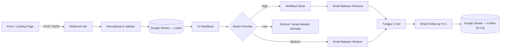

# Arsitektur — AI Lead Capture & Auto Follow-up

Demo ini menunjukkan alur otomasi lead end-to-end yang bisa dipakai untuk agensi, konsultan, klinik, sekolah, properti, atau bisnis B2B lain yang menerima lead dari landing page, Instagram, dan WhatsApp.

## Tujuan bisnis

- Menyimpan semua lead ke satu tempat tanpa input manual.
- Mengklasifikasi kualitas lead dalam hitungan detik.
- Memberi respons awal lebih cepat, terutama untuk lead bernilai tinggi.
- Menjalankan follow-up otomatis agar lead tidak hilang.
- Menyediakan data untuk mengukur performa channel dan kecepatan respons.

## Alur data



## Komponen

| Komponen | Fungsi |
|---|---|
| **Webhook** | Menerima payload JSON dari form, landing page, atau integrasi pihak ketiga. |
| **Normalisasi** | Merapikan nama, email, nomor WhatsApp (format `62...`), sumber, dan validasi minimum. |
| **Google Sheets** | Menyimpan lead mentah dan log follow-up. Mudah diganti ke CRM seperti HubSpot, Notion, atau Airtable. |
| **AI Klasifikasi** | Menentukan `priority`, `score`, `intent`, ringkasan, dan draft balasan. |
| **Switch** | Memisahkan jalur high, medium, dan low. |
| **Slack** | Notifikasi real-time ke channel sales untuk lead panas. |
| **Gmail** | Balasan awal dan follow-up H+1. Bisa diganti WhatsApp Business API. |
| **Wait** | Menunda follow-up selama 1 hari tanpa membuat proses blocking. |

## Kontrak output AI

AI diminta mengembalikan JSON:

```json
{
  "priority": "high",
  "score": 92,
  "intent": "whatsapp_automation",
  "summary": "Butuh otomasi follow-up WhatsApp untuk 3 cabang, budget 8 juta, mulai bulan depan.",
  "reply_draft": "Halo Rina, terima kasih...",
  "followup_draft": "Halo Rina, ingin menindaklanjuti..."
}
```

Aturan prioritas:

- **High** — kebutuhan jelas, budget disebut, timeline dekat, atau meminta demo/proposal.
- **Medium** — relevan, tetapi detail atau budget belum jelas.
- **Low** — hanya bertanya informasi umum atau di luar layanan.

## Penanganan error

- **Payload tidak lengkap** → Code node melempar error; n8n menandai eksekusi gagal dan webhook mengembalikan error.
- **AI mengembalikan teks non-JSON** → `Parse Hasil AI` mengekstrak objek JSON dengan regex dan memakai fallback `medium`.
- **Email kosong** → pengiriman dialihkan ke `SALES_EMAIL` agar notifikasi internal tetap masuk.
- **Duplikasi lead** → tambahkan node `Remove Duplicates` berdasarkan email/WhatsApp sebelum menyimpan.
- **Rate limit AI** → aktifkan retry pada node OpenAI (Settings → Retry On Fail).

## Keamanan & kepatuhan

- Form wajib memiliki **consent** sebelum data dikirim.
- Jangan menyimpan data sensitif (KTP, rekam medis) tanpa dasar hukum dan enkripsi.
- Batasi akses Google Sheets dan channel Slack ke tim yang berkepentingan.
- Simpan API key di credential n8n, bukan di kode workflow.
- Sediakan mekanisme opt-out pada setiap email follow-up.

## Metrik yang bisa dipantau

| Metrik | Cara mengukur |
|---|---|
| Waktu respons pertama | `created_at` → waktu email terkirim |
| Persentase lead panas | Jumlah `priority = high` / total lead |
| Follow-up terkirim | Baris di sheet `Follow-up Log` |
| Konversi per sumber | Bandingkan `source` dengan status `won` |
| Akurasi klasifikasi | Sampling manual 20 lead per minggu |

## Pengembangan lanjutan

1. Ganti Google Sheets dengan CRM (HubSpot/Airtable/Notion).
2. Tambahkan WhatsApp Business API untuk balasan dan follow-up.
3. Tambahkan dashboard analitik (lihat `dashboard/` untuk mock UI).
4. Tambahkan penjadwalan meeting otomatis (Cal.com/Calendly).
5. Tambahkan RAG dari dokumen layanan agar balasan AI lebih akurat.
